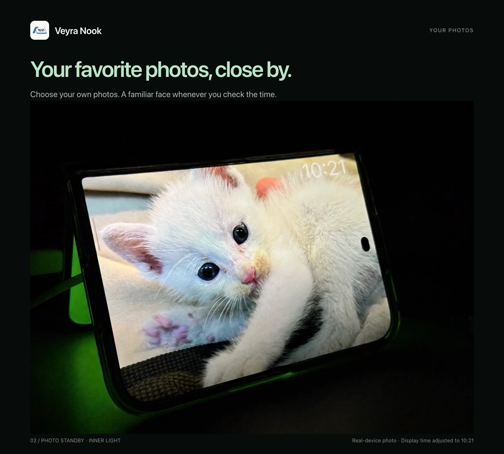
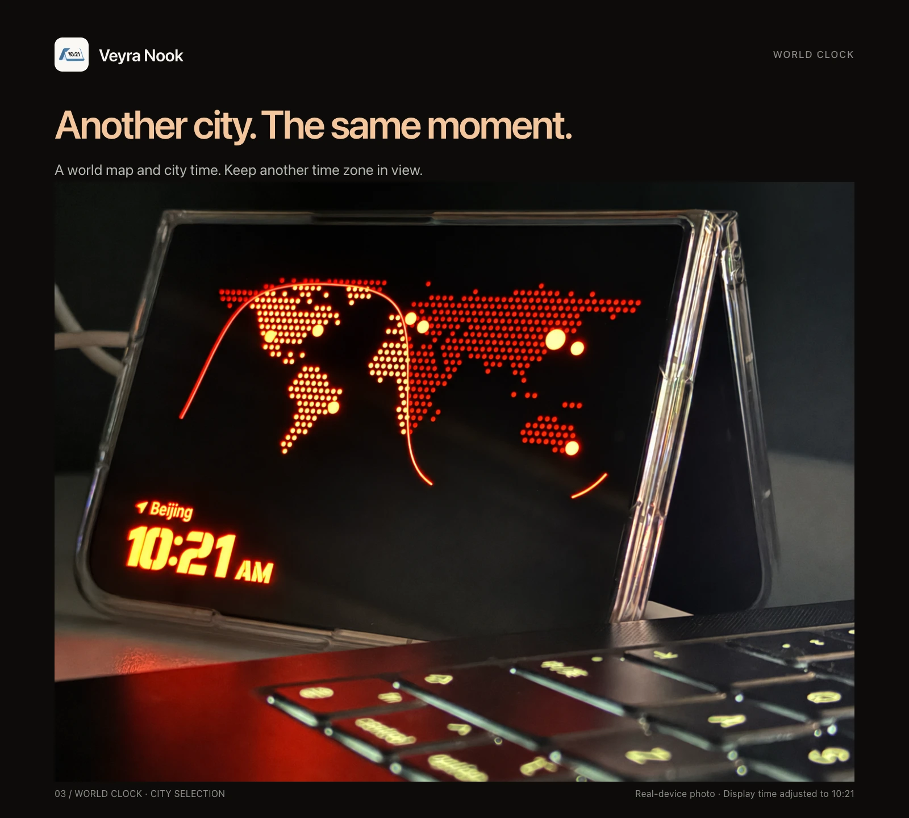
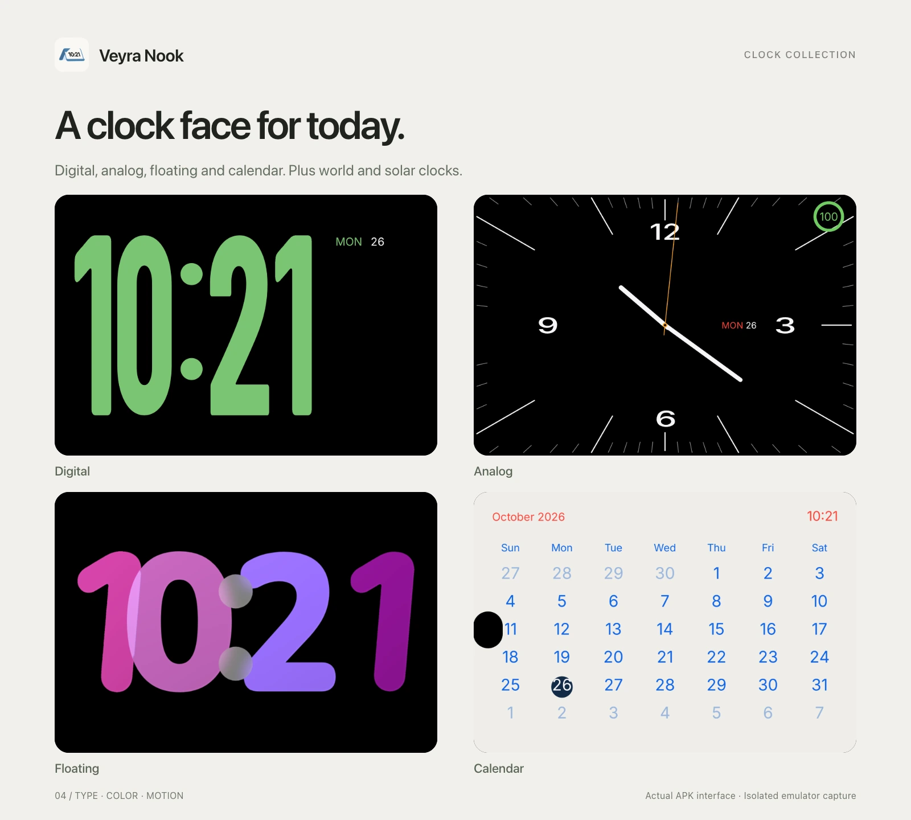
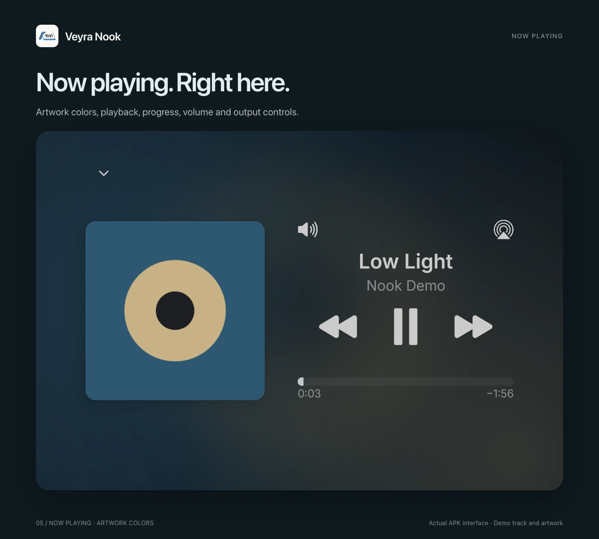
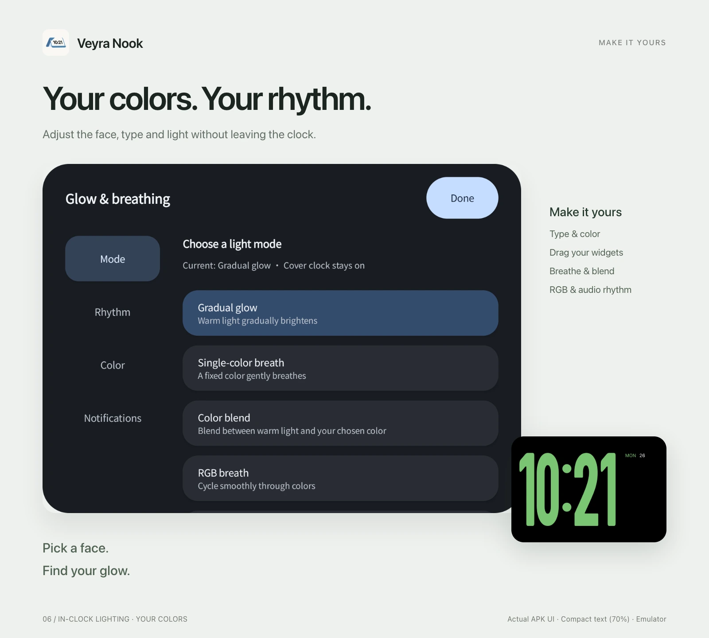

# Veyra Nook

**A place on your desk for your foldable: time and music outside, a soft glow inside.**

[简体中文](README.md) · English · [Downloads & release notes](https://github.com/AEMONET-Dev/VeyraNook/releases) · [Report an issue](https://github.com/AEMONET-Dev/VeyraNook/issues)

Nook is an Android foldable StandBy app **developed by AEMONET**. Fold your phone into a tent and place it on a desk or bedside table. The cover display shows a clock, photos, widgets or Now Playing, while the inner display provides adjustable ambient light.

**Currently in testing; no public APK is available yet.** Future builds will be published in this repository's Releases. Photos and screenshots below show development builds; consult each release's notes for its exact capabilities.

## What it does

| Feature | Experience |
| --- | --- |
| **Dual-display tent StandBy** | Information on the cover display and light on the inner display. With automation enabled, charging in a valid tent posture starts StandBy. |
| **Clock collection** | Digital, analog, world clock, solar and floating styles, plus a calendar page. Adjust type, colors and motion. |
| **Photos and widgets** | Choose your own photos. Configure the left and right widget stacks independently, drag to reorder and use the minus button to remove. |
| **Now Playing** | Actual artwork, title, artist and progress from the active media session; playback, track, seek, volume and output-device controls. |
| **Artwork colors** | The media background takes its colors from the current artwork, with transitions between tracks. |
| **Adjustable inner light** | Gradual warm light, single-color breathing, soft color transitions, RGB breathing, system-audio rhythm and battery-level breathing. Adjust color, period and intensity. |
| **Notification-color breathing** | Brief pulses use the source app icon's color, then return to the previous effect. Period and pulse count are adjustable. |
| **Gradual wake-up** | Reads the system's next alarm and begins brightening **3 minutes beforehand** by default, without creating a duplicate alarm. |
| **Two languages** | Simplified Chinese, English or system language, without changing the device language. |

Available media actions depend on the player. Output selection opens Android's system interface; it is not AirPlay.

## On a real device

<table>
<tr>
<td width="50%"></td>
<td width="50%"></td>
</tr>
</table>

All three device photos were supplied by the user; their display times have been edited to **10:21**, matching the app icon. Photo StandBy uses images you explicitly choose; the world clock lets you choose a city and time zone.

Edit appearance and light directly from the clock. Large digits support animated changes and gentle floating; widgets can be reordered by dragging. A camera-hole guide lets you mark the physical cutout and hide only nearby overlapping content, preserving the overall clock size and position.

## Music and light

Nook connects to your active player's media session. There is no need to import songs, and opening Now Playing does not start playback. Collapse it to return to your previous StandBy page.

**Audio rhythm analyzes system playback, not the microphone.** Only instantaneous volume intensity is analyzed; recordings are not saved. Some players, protected content and operating systems restrict capture, so rhythm response is not guaranteed for every source.

The inner display forms a continuous perimeter halo that fades smoothly to black in the center. Battery mode uses colors for charge ranges. A full battery gets slow breathing; recognized fast charging below full uses an inward-moving, fading halo. Fast-charge detection depends on the device's reported state and cannot identify every charging protocol.

> Clock, media and editor posters use actual APK screenshots captured on an isolated emulator. The media track and artwork are demo assets. They are interface captures, not concept UI renders. Clock captures use 10:21; the English editor poster uses the real compact-text setting (70%).

## Getting started

Once a public build is available:

1. Download and install the APK from [Releases](https://github.com/AEMONET-Dev/VeyraNook/releases).
2. Choose **Root or Shizuku** and grant permissions for the features you want.
3. Choose your clock, widgets and light, then enable automatic linkage.
4. Keep the phone charging and place it in a tent posture, **inner display facing the table and cover display facing out**. Wait for automatic entry.

Both “fold first, then plug in” and “plug in first, then fold” are supported entry paths. Automatic charging StandBy has no preview countdown while charging and posture remain valid. Unplugging, leaving the valid posture or exiting ends the session and withdraws its display requests. Timed manual preview is a separate mode.

## Devices and permissions

Installation requires **Android 13 or later**. Development and physical regression testing primarily target the **Xiaomi 18 Fold**; there is no established compatibility list for other foldables yet. Installation alone does not imply dual-display support.

The same APK retains **Root and Shizuku** backends. It uses your explicit selection and does not silently switch privilege modes when a backend fails. The Shizuku path has real Shell-identity execution evidence, but the test phone itself was rooted; this does not constitute complete validation on an unrooted device. Display control, posture recognition, automatic entry and audio capture depend on OEM system capabilities.

| Permission or setting | Purpose |
| --- | --- |
| Root or Shizuku | Dual-display coordination, protected display operations and system-playback analysis. |
| Notification access | Active media sessions and notification app icons/arrival times. Notification lighting does not read, save or upload notification bodies. |
| System next-alarm and exact-alarm capability | Schedule gradual wake-up without modifying your system alarms. |
| Explicitly selected photos | Photo StandBy without granting access to the whole library. |
| OEM lock-screen, auto-start and background settings | Some systems require these for charging entry while locked and sustained operation. |
| Install unknown apps | Used by Android's installer only when you confirm an app update. |

Nook does not record through the microphone and includes no advertising or behavioral analytics. Update requests access GitHub without uploading your notifications, photos or device logs.

### Brightness and display care

- **Cover brightness follows the system**, respecting automatic or manual mode without changing global brightness policy. Inner light has separate intensity and automatic adjustment.
- **Cover protection** combines slow pixel shifting and idle dimming of the complete page, including backgrounds, photos, media and the camera capsule. Interaction restores readability.
- **Inner protection** shifts the halo, varies its width, reduces prolonged intensity and limits sustained HDR/high-temperature output.
- **Idle refresh** requests 30Hz for Nook's window after 3 seconds and caps rendering at 30fps. Touch, drag, editing and transitions lift the limit; idle timing restarts afterward. Exit withdraws the request without changing global refresh settings. Actual panel frequency remains system-controlled and needs device-specific measurement.

These measures **mitigate OLED aging; they cannot guarantee freedom from burn-in**. Nook is not panel-level low-power AOD.

## Downloads, updates and project status

This is the official introduction, release and feedback repository. **There are currently no public releases, and the complete source has not been published.** Source publication will be addressed after asset provenance and licensing review. A custom clock-face community is planned, not available today.

The in-app updater checks stable releases by default, with optional beta releases. It verifies size, SHA-256, package identity, version and signing certificate before asking you to confirm Android installation. It does not silently install through Root. Before installation, Nook pauses its automatic entry and waits for its display state to restore.

GitHub availability depends on your network. Retry later or visit [Releases](https://github.com/AEMONET-Dev/VeyraNook/releases) manually. Published APKs and their release notes are the authority for each version.

## Feedback

Open an [issue](https://github.com/AEMONET-Dev/VeyraNook/issues) with your device, OS, Nook version, backend, reproduction steps and actual result. For display or automatic-entry issues, include charging state, lock state and folding movement. For audio issues, include the player name.

Remove private notifications, contacts and payment details from screenshots and logs. Do not submit signing keys or Root credentials.

## Development and optional support

**Developed by [AEMONET](https://github.com/AEMONET-Dev).** This version is free, with no feature tiers based on contributions.

It means a lot to know Nook has found a place on your desk. If you would like to help it reach its next version, optional WeChat or Alipay support is available in the app, in any amount you choose. Sharing your experience and reporting issues help too.

Not affiliated with Apple, Xiaomi, Shizuku or other privilege tools. Brands and third-party components retain their respective rights and licenses.
