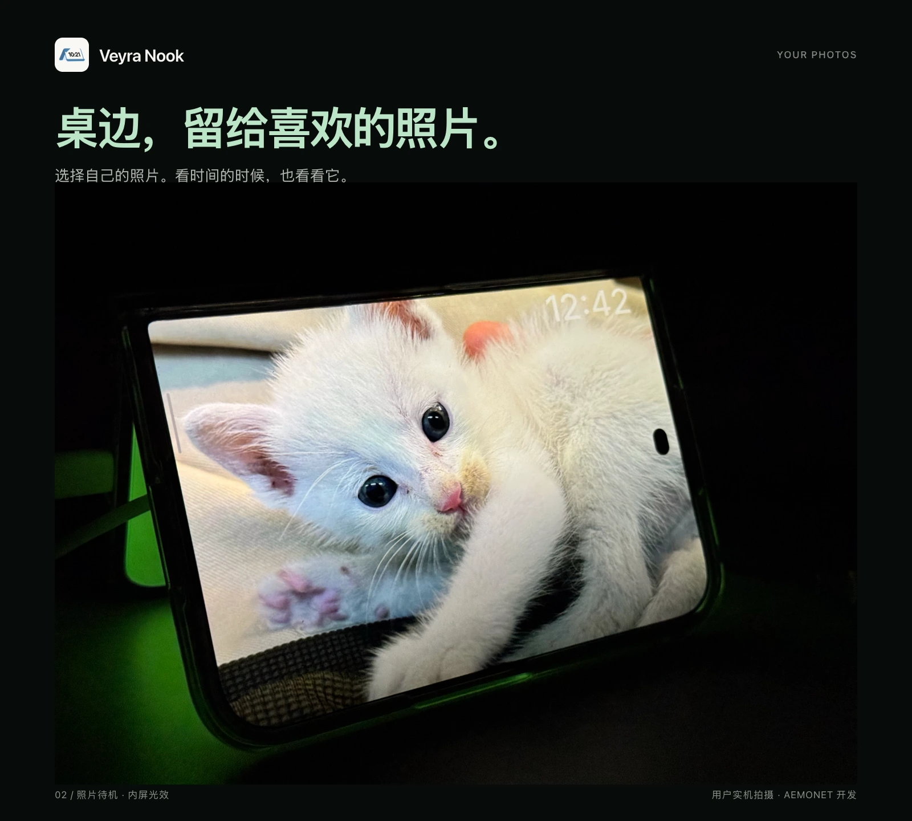
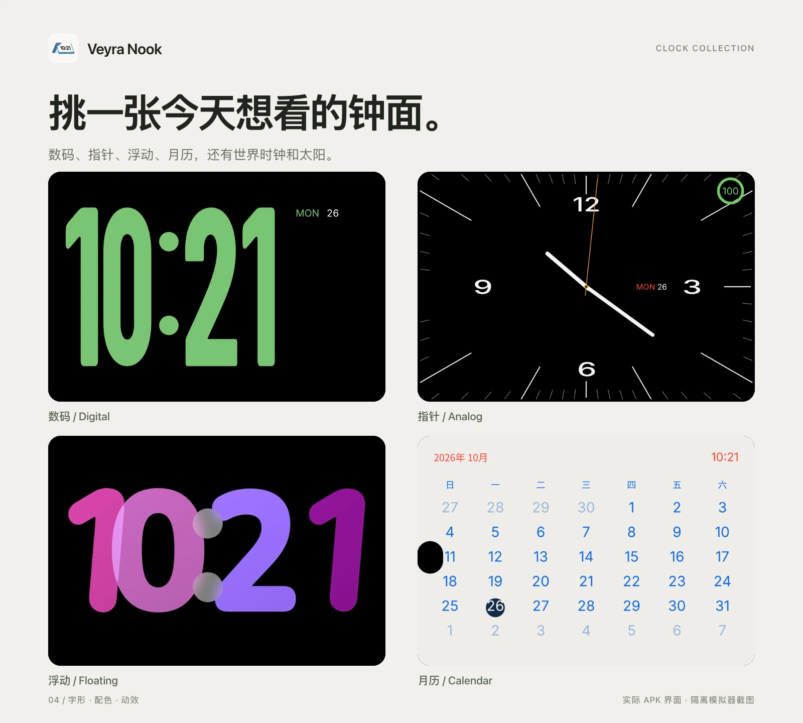
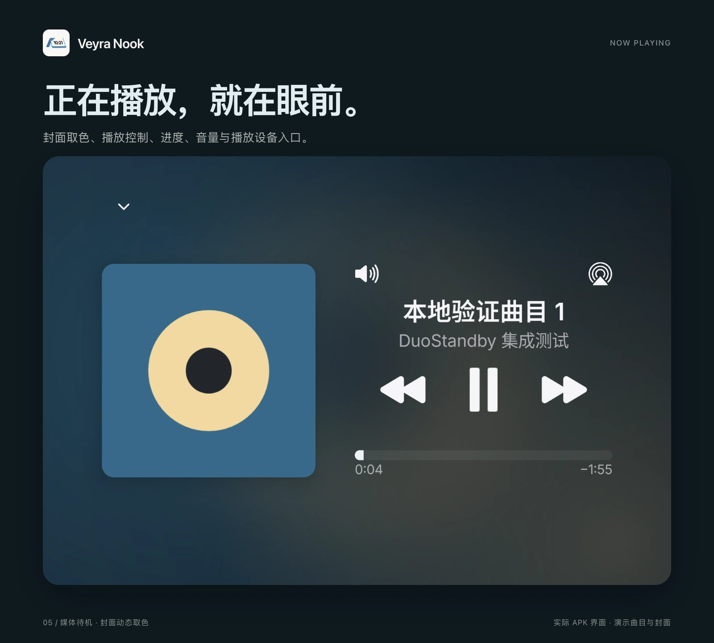
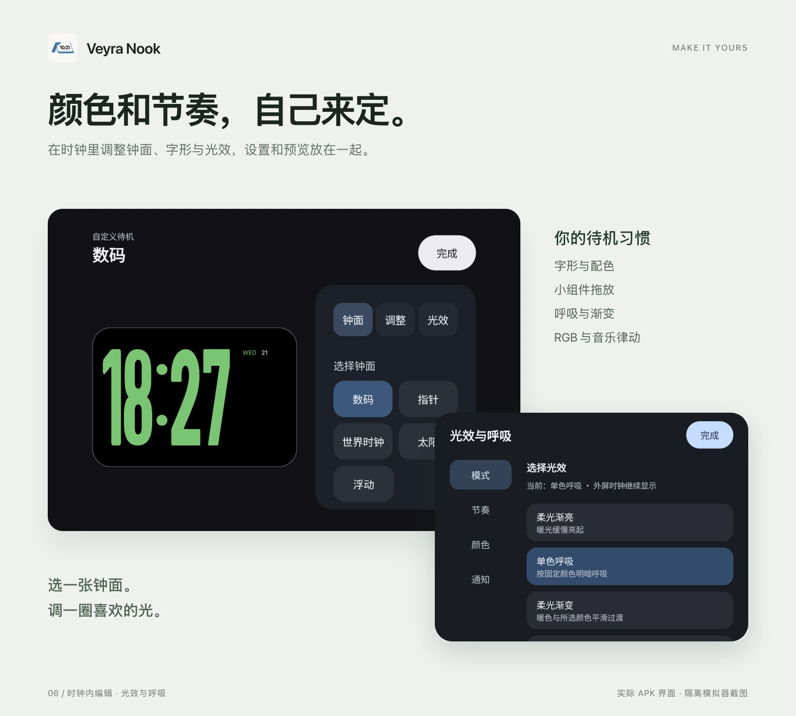

# Veyra Nook

**把折叠屏放在桌边，外屏看时间和音乐，内屏留一圈柔光。**

简体中文 · [English](README.en.md) · [下载与版本记录](https://github.com/AEMONET-Dev/VeyraNook/releases) · [问题反馈](https://github.com/AEMONET-Dev/VeyraNook/issues)

Nook 是由 **AEMONET 开发**的 Android 折叠屏待机应用。将手机半折成帐篷，放在桌面或床头：外屏显示钟面、照片、小组件或正在播放，内屏提供可调节的环境光。

**当前处于测试阶段，尚无公开 APK。** 后续安装包统一通过本仓库的 Releases 发布。下方实拍与 APK 界面来自开发版本，具体功能以所下载版本的更新记录为准。

## 可以用它做什么

| 功能 | 使用体验 |
| --- | --- |
| **帐篷双屏待机** | 外屏显示信息、内屏提供光效；开启自动联动后，充电并进入帐篷姿态时自动启动。 |
| **多种钟面** | 数码、指针、世界时钟、太阳与浮动样式；支持字形、配色和动效调整，另有月历页面。 |
| **照片与小组件** | 选择自己的照片；左右组件可独立配置，长按拖放调整顺序，用减号移除。 |
| **正在播放** | 显示当前媒体会话的封面、曲名、艺人和进度；支持播放/暂停、切歌、拖动进度、音量与播放设备入口。 |
| **封面取色** | 媒体页从实际封面提取颜色，让背景随封面变化，并为换曲加入过渡。 |
| **可调内屏光效** | 柔光渐亮、单色呼吸、柔光渐变、RGB 呼吸、系统音乐律动与电量呼吸；调节颜色、周期和强度。 |
| **通知取色呼吸** | 从通知来源应用的图标取色，短暂呼吸后回到原光效；可调节周期和次数。 |
| **柔光唤醒** | 读取系统“下一次闹钟”，默认提前 **3 分钟**开始渐亮，不另建一份闹钟。 |
| **中英双语** | 简体中文、English 或跟随系统，只切换 Nook 自身语言。 |

媒体操作取决于播放器公开的控制能力；播放设备入口使用 Android 系统提供的界面，不等同于 AirPlay。

## 放在桌边，也可以是另一种样子

<table>
<tr>
<td width="50%"></td>
<td width="50%"></td>
</tr>
</table>

三张实机照片由用户提供。照片页使用你主动选择的图片；世界时钟可选择城市与时区。

时钟内可调整外观与光效。大数字支持换字过渡和循环浮动；小组件支持拖放。对于挖孔屏，可手动标记前置摄像头的位置，只隐藏小孔附近相碰的局部内容，保留钟面的整体大小与位置。

## 音乐与灯光一起用

媒体页连接正在运行的播放器，不需要把歌曲导入 Nook。打开媒体页不会主动开始播放；收起后可以回到原待机页面。

**音乐律动分析的是系统正在播放的音频，不用麦克风。** 只分析瞬时音量强度，不保存录音。部分播放器、受保护内容或系统可能限制音频捕获，此时不保证有律动效果。

内屏光效沿四周形成连续光环，向中央平滑退黑。电量模式用颜色表示电量范围；已充满时慢呼吸，快充且未满时用向内推进并消退的光环表现充电。快充判断依赖设备提供的充电状态，不保证所有充电协议都能识别。

> 钟面、媒体和编辑海报使用实际 APK 的隔离模拟器截图；媒体曲目与封面为演示素材。海报用于展示界面，不是重新绘制的概念 UI。

## 如何开始

公开版本发布后，按以下步骤使用：

1. 从 [Releases](https://github.com/AEMONET-Dev/VeyraNook/releases) 下载 APK，完成安装。
2. 打开 Nook，选择 **Root 或 Shizuku** 后端，并只授予你需要的功能权限。
3. 选择钟面、组件和内屏光效，开启“自动联动”。
4. 保持充电，把手机半折成帐篷，**内屏朝向桌面、外屏朝外**，等待自动进入。

支持“先折好再插电”和“先充电再折入帐篷”两条入口。持续充电且保持有效姿态时，自动待机不会按预览倒计时关闭；拔电、离开有效姿态或主动退出时结束，并撤销自身显示请求。手动限时预览与持续自动待机是不同模式。

## 设备与权限

最低安装要求为 **Android 13**。当前开发与实机回归主要围绕 **小米 18 Fold**，其他折叠机型与系统版本尚未形成兼容名单。能安装不代表能够控制双屏。

同一 APK 保留 **Root / Shizuku** 两种后端，按用户选择使用；后端失效时不会悄悄改用另一种权限。Shizuku 路径已有真实 Shell 身份运行记录，但测试手机本身已 Root，不等于已经完成未 Root 机型的完整兼容验收。双屏、姿态识别、自启和音频捕获均依赖厂商系统能力。

| 授权或系统设置 | 用途 |
| --- | --- |
| Root 或 Shizuku | 内外屏协同、受保护显示操作与系统播放音频分析。 |
| 通知使用权 | 获取活动媒体会话，以及通知来源应用图标和到达时间；通知光效不读取、保存或上传正文。 |
| 系统下一次闹钟与精确闹钟能力 | 为柔光唤醒安排提前渐亮；不修改你的系统闹钟。 |
| 用户主动选择的照片 | 用于照片待机；无需把整个相册交给 Nook。 |
| 厂商的锁屏显示、自启动与后台运行设置 | 部分系统需要这些设置，才能在锁屏充电时启动并持续运行。 |
| 允许安装此来源的应用 | 仅在确认安装更新时交给 Android 系统安装器使用。 |

Nook 不使用麦克风录音；没有广告或行为分析。检查更新会访问 GitHub，不随更新请求上传通知、照片或设备日志。

### 亮度、屏幕保护与刷新率

- **外屏亮度跟随系统**：系统开自动亮度时由系统调节，手动模式时尊重手动设置；不改全局亮度策略。内屏有独立的光效强度与自动调节。
- **外屏保护**：缓慢微移，并对包含背景、照片、媒体与胶囊在内的整页做闲置渐暗；触摸或编辑时恢复可读性。
- **内屏保护**：光环缓慢位移、宽度缓变、长时间显示降强，并限制持续 HDR 与高温下的强度。
- **闲置刷新**：静置 3 秒后申请自身窗口 30Hz 并限制到 30fps；触摸、拖动、编辑和切换动画时解除限制，结束后重新计时。退出撤销请求，不改全局刷新率。面板是否实际降到 30Hz 由系统决定，仍需按机型实测。

这些是 **OLED 老化缓解措施，不是防烧屏保证**。当前待机也不是面板级低功耗 AOD。

## 下载、更新与项目进度

本仓库是 Nook 的官方介绍、发布与反馈渠道。**目前尚无公开发行版，也尚未公开完整源码。** 资源来源与许可整理完成后，再说明源码发布安排；钟面自定义社区属于后续计划，当前未提供。

应用内“版本与更新”默认检查稳定版，可选择接收测试版。下载后校验文件大小、SHA-256、APK 包名、版本与签名，再由你确认系统安装；不使用 Root 静默安装。安装前会暂停自身自动入口，等待显示恢复。

GitHub 在部分网络环境下可能无法访问；可以稍后重试，或手动打开 [Releases](https://github.com/AEMONET-Dev/VeyraNook/releases)。公开版本以 Release 中的 APK 和更新记录为准。

## 反馈问题

请到 [Issues](https://github.com/AEMONET-Dev/VeyraNook/issues) 提供：设备型号、系统版本、Nook 版本、所用后端、复现步骤，以及实际结果。双屏与自启问题请补充当时是否充电、是否锁屏、如何折叠；音频问题请补充播放器名称。

截图和日志先去掉私人通知、联系人、付款信息等内容。请不要提交签名密钥或 Root 凭据。

## 开发与自愿支持

**[AEMONET](https://github.com/AEMONET-Dev) 开发。** 本版本免费使用，功能不按支持金额区分。

很高兴，Nook 能在你的桌边留下一点位置。如果你也愿意陪它走向下一个版本，可以在应用内用微信或支付宝自愿支持，金额自定。分享体验、提交问题，同样是在帮助它变好。

与 Apple、小米、Shizuku 及其他权限工具无隶属关系。品牌与第三方组件分别保留各自的权利与许可。
